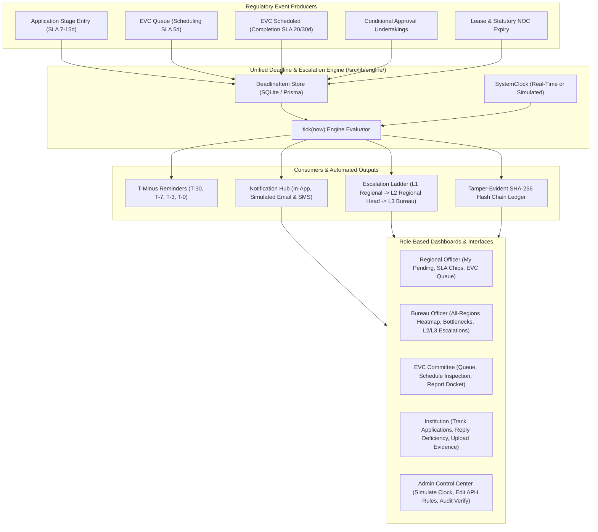

# 🎓 AICTE Flow — Workflow Automation, Compliance Monitoring & Alert Management System

> **Problem Statement ID:** 26262  
> **Target:** Autonomous AICTE Approval Workflow Automation, Generic Deadline & Escalation Engine, and Compliance Surveillance System.

---

## 📌 Executive Summary

**AICTE Flow** is a unified digital platform where AICTE applications are routed automatically through the statutory approval stages (*Scrutiny, Re-Scrutiny, EVC Queue, EVC Inspection, EVC Report Review, SAC/SHC, Decision Pending*) in strict alignment with the AICTE Approval Process Handbook (APH).

**§19 / PS-gap extras:** APH intake hard-block + faculty gate, clause-labelled norms card + deficiency prefill, institution/region Compliance Health Score (0–100), dual-clock bar, live Refer-to-SAC/SHC routing, Admin audit tamper demo, Simulation Impact Summary, role accents, document validity bars.

At its core operates a **generic deadline & escalation engine** that unifies all time-bound regulatory operations:
1. **Application stage timelines** (SLA per processing stage)
2. **EVC inspection scheduling & completion** (tighter 30-day tracking for new institutions)
3. **Institutional undertakings & conditional approvals** (due dates with evidence verification)
4. **Lease deed & statutory document validity monitoring** (90/60/30-day proactive expiry tracking)

Every time-bound item is modeled as a unified `DeadlineItem`. A simulated clock allows fast-forwarding time to demonstrate automated T-minus reminder alerts (in-app, email, SMS simulation), progressive escalation ladders to senior officers, and an immutable SHA-256 cryptographic hash-chained audit log.

---

## 🏗️ System Architecture



---

## 🛠️ Tech Stack

| Component | Technology | Rationale |
|---|---|---|
| **Framework** | Next.js 16 (App Router) + TypeScript | Modern React Server Components, server actions & API routes |
| **Database** | SQLite via Prisma ORM | Zero-setup, portable `dev.db`, ACID transactions |
| **Styling** | Vanilla CSS + Tailwind tokens | High-performance institutional design, responsive SLA chips |
| **Visualizations** | Recharts | Interactive stage pendency, region distribution & ageing charts |
| **Date & Time** | `date-fns` + Centralized `getNow()` | Simulated date manipulation across all business logic |
| **Security & Audit** | Node.js Crypto (SHA-256 Hash Chaining) | Immutable, tamper-evident verifiable ledger |
| **Communication** | Notification Hub (In-App + Simulated Email/SMS) | Zero external dependency demo delivery log |

---

## 🚀 Quick Start Guide

### 1. Installation
```bash
# Clone the repository and enter the directory
cd aicte-flow

# Install dependencies
npm install
```

### 2. Database Sync & Realistic Seed
Seeds 8 AICTE regions, ~60 institutions, ~200 applications across all 5 approval routes, EVC visits, conditional undertakings, lease documents, notifications, and initializes the SHA-256 audit ledger:
```bash
npm run seed
```

### 3. Run Development Server
```bash
npm run dev
```
Open [http://localhost:3000](http://localhost:3000) in your browser.

### 4. Build for Production
```bash
npm run build
npm run start
```

---

## 🔑 Demo User Accounts

Switch roles dynamically anytime using the **"Switch user"** dropdown in the top navigation bar, or select from the role cards on the login page:

| Role | Demo Account Email | Scope & Privileges |
|---|---|---|
| **System Admin** | `admin@demo.aicte` | Clock control (+1d, +7d, +30d), APH rules editor, user directory, audit chain verify, demo reset |
| **Bureau Officer** | `bo.alpha@demo.aicte` | All-regions oversight, bottleneck analytics, L2/L3 escalations, competent authority decisions |
| **Regional Officer (Central)** | `ro.central.alpha@demo.aicte` | Central region applications, scrutiny, deficiency returns, schedule EVC, verify undertakings |
| **Regional Officer (Southern)** | `ro.southern.alpha@demo.aicte` | Southern region applications, scrutiny, verify renewals |
| **EVC Committee** | `evc.member1@demo.aicte` | EVC inspection queue, date scheduling, submit visit report reference |
| **SAC / SHC Member** | `sac.member@demo.aicte` | Standing Appeal Committee & Hearing Committee stage evaluations |
| **Institution** | `inst.1.apex...technol...` | Submit new applications, respond to deficiencies, upload undertaking compliance, renew leases |

---

## 🎯 Golden Demo Applications

The database seeds five dedicated **golden demo applications** representing each Approval Process Handbook route:

| Application Ref | Type | Route | Purpose in Demo |
|---|---|---|---|
| `DEMO-NEW-INST-001` | `NEW_INSTITUTION` | `SCRUTINY_EVC_SAC_SHC` | Full end-to-end statutory route with strict 30d EVC timeline |
| `DEMO-NEW-COURSE-002` | `NEW_COURSE` | `SCRUTINY_EVC` | Fast-track scrutiny into EVC inspection |
| `DEMO-EXTENSION-003` | `EXTENSION` | `ONLY_SCRUTINY` | Standard annual Extension of Approval (EoA) |
| `DEMO-INTAKE-004` | `INTAKE_INCREASE` | `SCRUTINY_EVC` | Scrutiny and infrastructure validation for intake hike |
| `DEMO-EVC-SAC-005` | `NEW_COURSE` | `EVC_SAC_SHC` | Standing Hearing Committee review flow |

---

## 🛡️ Statutory & Regulatory Safeguards

1. **Human Oversight is Non-Negotiable:** The system **never** auto-approves or auto-rejects an application. The automation moves files between queues, raises SLA warnings, and drafts case summaries; an authorized human officer executes every statutory decision (`DECIDED`).
2. **No Auto-Verification:** Document renewals and undertaking evidence uploads remain in `SUBMITTED` / `RENEWAL_SUBMITTED` state until verified by a Regional Officer.
3. **Mandatory Return Reasons:** Applications cannot be returned to an institution without a detailed deficiency reason (minimum 10 characters), recorded in observations and the audit trail.
4. **Tamper-Evident Hash Chain:** Every system action is cryptographically hashed with its preceding block (`prevHash + ts + actor + action + entity + payload`). The `/audit` interface provides a one-click chain verification tool.
5. **Persistent Statutory Notice:** Every page displays the banner: *"Automated alerts and workflow actions support the approval process. They do not replace statutory scrutiny, verification, inspection or decisions of the competent authority."*

---

## 📁 Repository Structure

```
aicte-flow/
├── app/
│   ├── (app)/
│   │   ├── admin/                # Admin control center (clock, rules, users)
│   │   ├── applications/         # Applications list, search, filter & details
│   │   │   ├── [id]/             # Detail stepper, timeline, observations, action panel
│   │   │   └── new/              # Institution new application submission form
│   │   ├── audit/                # Tamper-evident SHA-256 audit log & verification
│   │   ├── dashboard/            # Role-specific dashboards (RO, BO, EVC, Inst, Admin)
│   │   ├── documents/            # Lease & NOC expiry surveillance & renewals
│   │   ├── escalations/          # Escalation hierarchy tracking & actions
│   │   ├── evc/                  # EVC queue, scheduling modal, report submission
│   │   │   └── [id]/             # Schedule & complete inspection form
│   │   ├── notifications/        # In-app inbox & simulated Email/SMS delivery log
│   │   ├── reports/              # 6 analytical reports with CSV exports
│   │   ├── undertakings/         # Conditional approval undertaking compliance
│   │   └── layout.tsx            # App shell with role-scoped nav, clock badge & user switcher
│   ├── api/                      # RESTful route handlers for all mutations & exports
│   ├── globals.css               # Design system tokens, SLA chips & glassmorphic styling
│   └── page.tsx                  # Role card login page
├── prisma/
│   ├── schema.prisma             # Full relational schema with indexes
│   └── seed.ts                   # Seed script generating ~200 realistic applications
├── src/
│   ├── config/
│   │   └── rules.ts              # APH route mappings, stage timelines & alert thresholds
│   └── lib/
│       ├── audit.ts              # SHA-256 append-only cryptographic hash chain
│       ├── auth.ts               # Demo auth & server-side role validation
│       ├── clock.ts              # Simulated clock provider (getNow)
│       ├── db.ts                 # Prisma client singleton
│       ├── notify.ts             # Notification dispatcher (In-App, Email, SMS)
│       ├── engine/
│       │   └── tick.ts           # Core deadline & escalation evaluation engine
│       └── workflow/
│           └── workflow.ts       # Route state machine, auto-hooks, advances & returns
├── DECISIONS.md                  # Architectural decisions, trade-offs & future roadmap
├── DEMO_SCRIPT.md                # 5-minute live demonstration walkthrough
└── README.md                     # Product documentation
```
